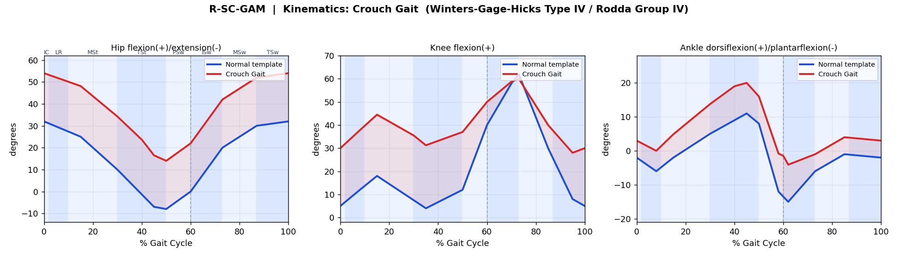
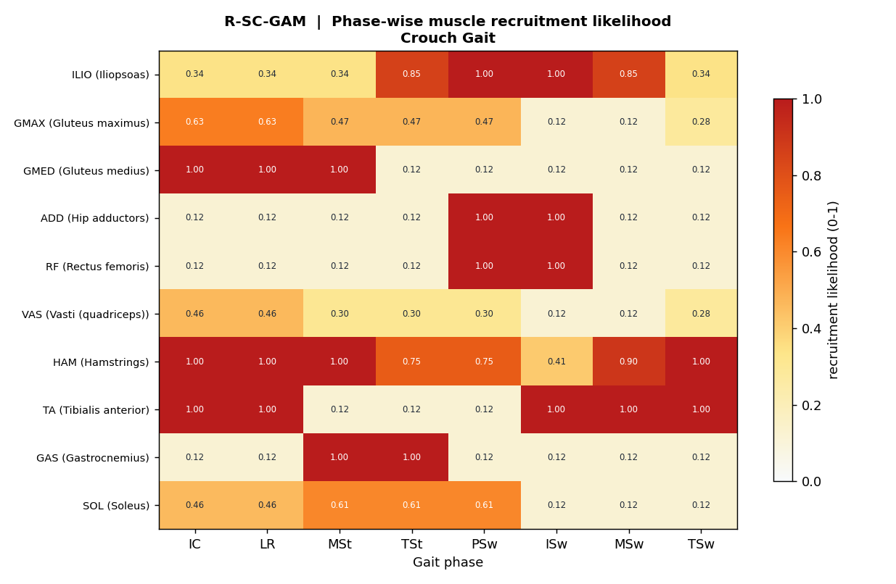
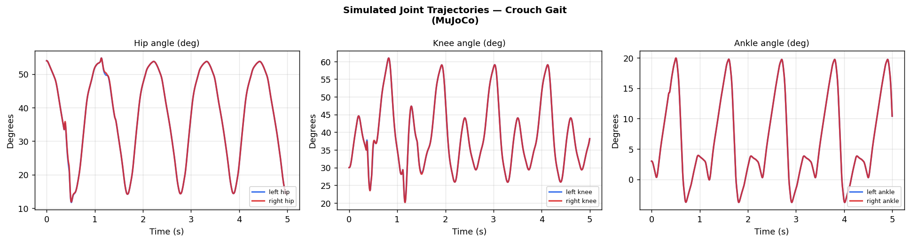
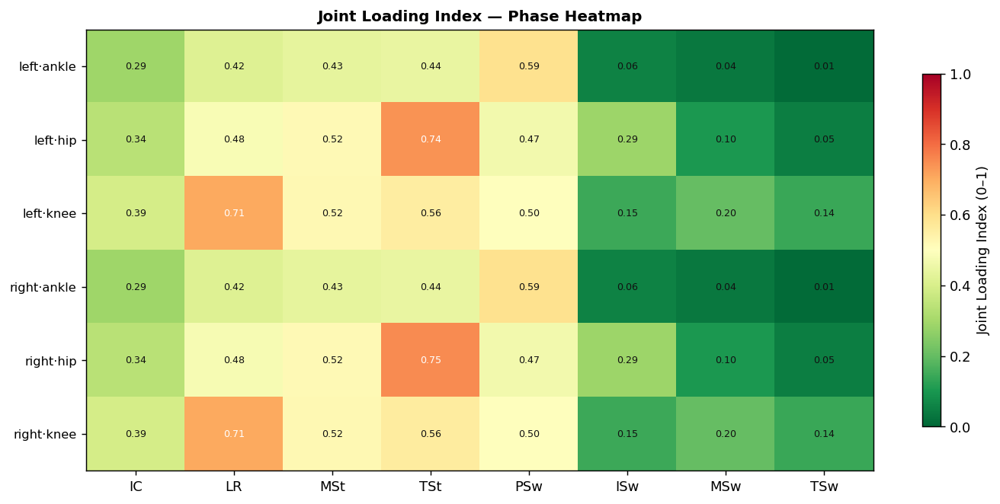

# CP-RL — Computational Gait & Rehabilitation Modelling for Spastic Cerebral Palsy

Computational framework that maps clinically recognised **spastic cerebral palsy (CP) gait archetypes** to
phase-wise muscle recruitment likelihood, rehabilitation-priority indices, **MuJoCo physics-based joint loading**,
and muscle-tendon stress–strain proxies. All code and generated results are included in this repository.

> **Scientific boundary:** research / hypothesis-generation tool. Outputs are literature-informed estimates —
> not measured EMG, not a diagnosis, and not a clinical prescription.

## Repository layout

| Folder | What it is |
|---|---|
| [`r_sc_gam/`](r_sc_gam) | **R-SC-GAM** — standalone gait archetype mapper (numpy/pandas/matplotlib). Spasticity rules, recruitment matrices, Rehab Priority Index (RPI), gait classifier, therapist / parent / child reports. |
| [`r_sc_gam/results/`](r_sc_gam/results) | 56 generated outputs: kinematics, recruitment heatmaps, RPI charts, CSV matrices and reports for all 6 archetypes + classifier demo. |
| [`r_sc_gam_mujoco_ssl/`](r_sc_gam_mujoco_ssl) | **R-SC-GAM-MJ-SSL** — extends the model with a 6-DOF MuJoCo biped, mechanical loading engine, stress–strain engine, composite rehab-risk engine and a Streamlit UI. |
| [`r_sc_gam_mujoco_ssl/outputs/`](r_sc_gam_mujoco_ssl/outputs) | 181 generated outputs: 6 archetypes × 3 severities — MuJoCo joint trajectories, torque & loading heatmaps, tendon-length proxies, stress–strain and risk CSVs, reports. |

## Archetypes modelled

| Key | Archetype | Classification |
|---|---|---|
| `true_equinus` | True Equinus | Winters-Gage-Hicks II / Rodda I |
| `jump` | Jump Gait | Winters-Gage-Hicks III / Rodda II |
| `apparent_equinus` | Apparent Equinus | Rodda III |
| `crouch` | Crouch Gait | Winters-Gage-Hicks IV / Rodda IV |
| `stiff_knee` | Stiff-Knee Gait | Sutherland & Davids |
| `drop_foot` | Drop Foot | Winters-Gage-Hicks I |

## Key results

### R-SC-GAM — top rehabilitation priority per archetype

| Archetype | Top-priority muscle | RPI | Suggested focus |
|---|---|---|---|
| True Equinus | Soleus | 47 | Spasticity management |
| Jump Gait | Soleus | 42 | Spasticity management |
| Apparent Equinus | Hamstrings | 46 | Spasticity management |
| Crouch Gait | Hamstrings | 56 | Spasticity management |
| Stiff-Knee Gait | Rectus femoris | 36 | Spasticity management |
| Drop Foot | Tibialis anterior | 19 | Strengthening / motor control |

**Gait classifier demo** (noisy synthetic crouch observation): correctly identified *Crouch Gait*
(similarity 0.860, RMS 1.62°) vs. next-best *Apparent Equinus* (0.582).

### MuJoCo stress–strain pipeline — composite rehab risk (0–100), bilateral

| Archetype | Mild | Moderate | Severe | Top-risk muscle |
|---|---|---|---|---|
| True Equinus | 11.2 | 20.4 | 30.3 | Soleus |
| Jump Gait | 10.2 | 18.6 | 27.5 | Soleus |
| Apparent Equinus | 11.7 | 21.0 | 30.9 | Iliopsoas |
| Crouch Gait | 13.1 | 23.3 | 34.0 | Hamstrings → Iliopsoas (severe) |
| Stiff-Knee Gait | 10.5 | 18.3 | 26.3 | Rectus femoris |
| Drop Foot | 6.2 | 11.1 | 16.1 | Iliopsoas |

Full table: [`r_sc_gam_mujoco_ssl/outputs/_BATCH_SUMMARY.csv`](r_sc_gam_mujoco_ssl/outputs/_BATCH_SUMMARY.csv).
Risk rises monotonically with severity for every archetype, and crouch gait carries the highest mechanical burden.

### Sample figures

| | |
|---|---|
|  |  |
|  |  |

## Reproduce

```bash
pip install -r r_sc_gam_mujoco_ssl/requirements.txt

# 1) Standalone archetype mapper -> r_sc_gam/results/
python r_sc_gam/r_sc_gam.py

# 2) MuJoCo + stress-strain batch (6 archetypes x 3 severities) -> r_sc_gam_mujoco_ssl/outputs/
python r_sc_gam_mujoco_ssl/run_batch.py

# 3) Interactive app
cd r_sc_gam_mujoco_ssl && streamlit run app.py
```

Tested with Python 3.10, MuJoCo 3.6.

## Engineering notes

- Fixed the MJCF sensor tag (`actuatorforce` → `actuatorfrc`) that made MuJoCo silently fall back to the proxy model.
- Fixed a physics blow-up: a `<default><motor gear="50">` was being inherited by the `<position>` servos
  (effective stiffness kp·gear² ≈ 5×10⁵ N·m/rad). Removed it, added realistic paediatric segment masses, joint
  armature and the `implicitfast` integrator, plus a divergence guard that falls back to the proxy instead of
  reporting garbage as success.
- Added `run_batch.py` for headless, reproducible generation of every figure, CSV and report.

## Literature basis

Perry & Burnfield (Gait Analysis, 2nd ed.); Kadaba et al. 1990; Winters, Gage & Hicks 1987; Rodda & Graham 2001,
Rodda et al. 2004; Sutherland & Davids 1993; Lance 1980; Bohannon & Smith 1987; Palisano et al. 1997 (GMFCS);
Arnold et al. 2010.

## Context

Built for computational rehabilitation research — CNS Lab / R2D2, Dept. of Medical Science & Technology, IIT Madras.
